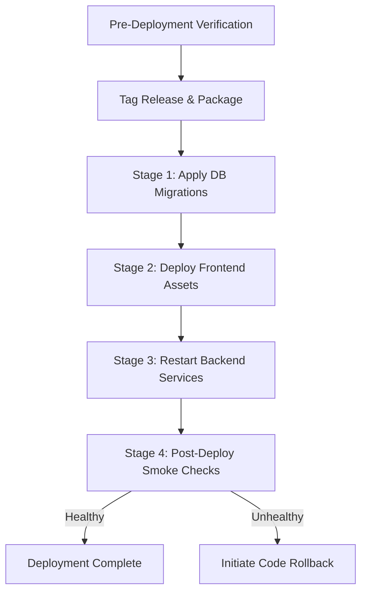

# Runbook 02: Manual Deployment and Code Rollback

**Target Audience:** Release Engineers, Platform Operators  
**Document Classification:** Operational Runbook  
**Last Updated:** Phase 7G  

---

## 1. Operational Overview & Boundaries

The deployment of VibeConnect is executed **manually by the human operator**. Automated CI/CD deployment agents, remote SSH execution, and automated Git repository operations are deliberately excluded from the automated coding agent's scope.

> [!IMPORTANT]
> **Operator Ownership**  
> All Git commits, tags, pushes, server SSH connections, web server reloads, and database migration executions are managed manually by the human platform operator. `OPERATOR ACTION REQUIRED: Execute release stages manually`.

---

## 2. Pre-Deployment Verification Checklist

Before deploying any release candidate to a staging or production host, complete the following local verification steps:

### Stage 1: Dependency & Test Gate
1. Execute unit, isolation, and regression suites:
   ```bash
   # Backend canonical verification (isolated Django test runner)
   python backend/manage.py test apps.access_control apps.identity apps.auditlog apps.integration_hub apps.developer_console common.tests --settings=config.settings.local

   # Frontend unit and accessibility tests
   cd frontend && npm test
   ```
2. Verify zero test failures before proceeding.

### Stage 2: Production Security Check
Execute Django's deployment security check against production settings:
```bash
python backend/manage.py check --deploy --settings=config.settings.production
```
- **Expected Outcome:** 0 errors. Warnings must be reviewed against reverse-proxy SSL termination assumptions.
- **Fail Condition:** Any security-blocking error halts the release.

### Stage 3: Frontend Build Compilation
Compile and validate the frontend bundle:
```bash
cd frontend
npm run build
```
- **Expected Outcome:** Clean compilation with exit code 0; bundle assets generated in `frontend/dist/`.
- **Fail Condition:** Any TypeScript or bundling error halts the release.

### Stage 4: Migration Inspection & Approval
Inspect outstanding database migrations:
```bash
python backend/manage.py showmigrations --settings=config.settings.production
```
For any unapplied migration, inspect the raw SQL before applying:
```bash
python backend/manage.py sqlmigrate <app_label> <migration_name> --settings=config.settings.production
```
> [!WARNING]
> **Backward Compatibility Requirement**  
> Migrations must be backward-compatible with running code. Never apply destructive column drops, renames, or table removals in a deployment that has not yet transitioned all running application nodes to the new code. `PLATFORM OWNER APPROVAL REQUIRED: Approve unapplied migrations`.

---

## 3. Manual Production Deployment Procedure

Follow these ordered stages during a scheduled deployment window:



### Step 1: Record Release Identity
Establish the release version or commit hash (e.g., `v1.2.0` or git SHA `a1b2c3d`). Record this identifier in the deployment log.

### Step 2: Database Migration Execution
On the target production server, execute migrations:
```bash
python manage.py migrate --settings=config.settings.production
```
If migration fails: **STOP IMMEDIATELY**. Do not proceed to backend restart. Assess the database error.

### Step 3: Deploy Frontend Assets
Synchronize the contents of `frontend/dist/` to the static hosting target or web server document root:
`OPERATOR ACTION REQUIRED: Sync frontend/dist/ to production web server / CDN`.

### Step 4: Restart Backend Services
Restart the WSGI/ASGI application workers and background worker processes:
```bash
# Example service restart (operator environment dependent)
sudo systemctl restart vibeconnect-backend
sudo systemctl restart vibeconnect-worker
```
`OPERATOR ACTION REQUIRED: Execute service restart on production host`.

---

## 4. Post-Deployment Smoke Verification

Immediately following service restart, perform these validation checks:

| Check | Target Endpoint | Expected Result | Action on Failure |
|---|---|---|---|
| **Liveness** | `GET /api/v1/health/` | HTTP 200 `{"status": "ok"}` | Check WSGI server process status |
| **Readiness** | `GET /api/v1/health/ready/` | HTTP 200 `{"status": "ready"}` | Check PostgreSQL connection / credentials |
| **Active Context** | `GET /api/v1/identity/active-context/` | HTTP 200 / 401 (Auth required) | Verify API gateway routing |
| **Frontend Shell** | `GET /` | HTTP 200 HTML page loads clean | Check web server index.html routing |

### Release Abort Triggers
Immediately abort the release and initiate rollback if:
1. `/api/v1/health/ready/` returns HTTP 503 or times out.
2. The WSGI service enters a crash loop (`exit status 1`).
3. Core API routes return unexpected HTTP 500 internal server errors.
4. Database migrations fail midway.

---

## 5. Application Code Rollback Procedure

> [!CAUTION]
> **Code Rollback vs. Database Disaster Recovery**  
> Rolling back application code is a routine operational procedure to return to the prior known-good version. It does NOT involve restoring database backups or executing destructive database commands. Never run `dropdb` or restore a database dump as a routine code rollback.

### Rollback Steps:
1. **Identify Previous Known-Good Build:**  
   Locate the previous stable release commit or artifact tag (e.g., `v1.1.9`).
2. **Re-deploy Previous Frontend Bundle:**  
   Restore the `frontend/dist/` artifact from the previous release to the static host.
3. **Revert Backend Code:**  
   Point the application host to the previous code version or checkout the prior release tag.
4. **Reverse Non-Destructive Migrations (If Required):**  
   If a migration was applied that is strictly incompatible with the previous code, and if a reversible migration path exists:
   ```bash
   python manage.py migrate <app_label> <previous_migration_name> --settings=config.settings.production
   ```
   > [!WARNING]
   > Do not reverse migrations if doing so will cause unrecoverable data loss for data written during the release window.
5. **Restart Backend Services:**  
   Restart the WSGI and background worker processes.
6. **Execute Smoke Checks:**  
   Validate `/api/v1/health/` and `/api/v1/health/ready/`.
