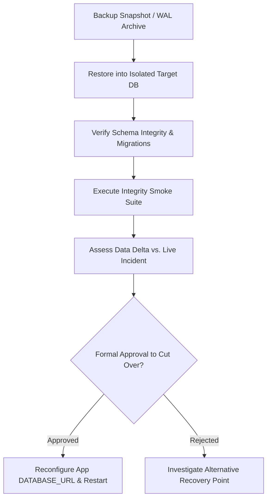

# Runbook 03: Database Backup, Restore, and Disaster Recovery

**Target Audience:** Database Administrators, Site Reliability Engineers, Platform Operations  
**Document Classification:** Operational Runbook  
**Last Updated:** Phase 7G  

---

## 1. Authoritative Application Data Inventory

100% of VibeConnect's persistent state is stored in PostgreSQL across 20+ core applications and 70+ database tables. There are zero external state dependencies (no persistent Redis data, no external blob storage for business records):

| Application Domain | Core Tables & Entities Persisted | Sensitivity / Impact |
|---|---|---|
| **Identity & Auth** | `PlatformUser`, `LoginAttempt`, `SupportImpersonationSession` | PII, credentials, session hashes |
| **Tenants & Members** | `Organization`, `OrganizationMembership` | Multi-tenant scoping root |
| **Catalog & Plans** | `Product`, `ProductModule`, `Plan`, `PlanVersion`, `PlanPrice` | Commercial service definitions |
| **Commercial Grants**| `OrganizationSubscription`, `SubscriptionProductEntitlement`, direct entitlements | Licensing & feature entitlement state |
| **Access Control** | `Role`, `RolePermission`, `OrganizationPermissionCeiling` | Tenant RBAC & security boundaries |
| **User Assignments** | `UserProductAssignment`, `UserModuleAssignment` | Seat allocations & end-user entitlements |
| **Audit Trails** | `AuditLog` (append-only compliance event ledger) | Immutable compliance log |
| **Integration Hub** | `ConnectorInstance`, `IntegrationEvent`, `ProvisioningJob`, `IntegrationFailure`, `IntegrationReconciliationIssue`, `ExternalTenantMapping`, `ExternalUserMapping` | Downstream synchronization & dead-letter queue |
| **Developer Console**| `DeveloperApplication`, `DeveloperApiKey`, `DeveloperWebhookSubscription`, `DeveloperWebhookDelivery` | Third-party developer API access & webhooks |
| **Async Operations** | `BackgroundJob`, `NotificationTemplate`, `NotificationDelivery` | Bulk imports & async notifications |

---

## 2. Assessment of Existing Repository Backup Files

The repository contains two static SQL dumps located in `backups/`:
- `vibeconnect_phase2c_test_20260923_135915.sql` (schema and test state snapshot from Phase 2C testing)
- `vibeconnect_phase2c_test_pre_stage7.sql` (test database snapshot created prior to Stage 7 manual QA)

> [!WARNING]
> **Historical Development Artifacts — Unsuitable as Production Recovery Points**  
> These files are historical development and testing snapshots created during Phase 2C manual QA. Their provenance, completeness, and schema compatibility with subsequent migrations (Phases 3 through 7) are unverified. They predate critical database tables and models introduced in later phases—including Integration Hub (`apps.integration_hub`), Developer Console (`apps.developer_console`), Notifications (`apps.notifications`), Usage Metering (`apps.usage_metering`), and Observability enhancements.  
> Restoring these historical files into a modern staging or production environment presents substantial schema regression and data-loss risks. They must not be treated as approved production recovery points unless their compatibility and integrity are independently verified within an isolated test environment.

---

## 3. Production Backup Requirements & Architecture

A compliant, production-grade backup strategy requires external managed infrastructure. The application codebase cannot execute its own automated database backup.

### 3.1. External Managed Backup Requirements (`EXTERNAL INFRASTRUCTURE NOT VERIFIED`)
1. **Automated Daily Full Backups:** Captured via cloud database snapshots (e.g., AWS RDS automated backups, GCP Cloud SQL, or Azure Database for PostgreSQL) or scheduled `pg_dump` jobs.
2. **Write-Ahead Log (WAL) Archiving:** Continuous WAL shipping enabling Point-in-Time Recovery (PITR) with granularity down to the second.
3. **Encryption at Rest:** All backup snapshots and WAL archives must be encrypted using provider-managed or KMS-managed keys.
4. **Access Control & Immutability:** Backup storage buckets must be isolated with strict IAM permissions, prohibiting unauthorized deletion or modification (WORM / Object Lock).
5. **Cross-Region Replication:** Critical snapshots replicated to an alternate cloud region to survive catastrophic datacenter loss.

### 3.2. RPO and RTO Targets (`PLATFORM OWNER APPROVAL REQUIRED`)
- **Recovery Point Objective (RPO):** Maximum allowable data loss measured in time (e.g., `< 5 minutes` via continuous WAL archiving). *Status: UNAPPROVED.*
- **Recovery Time Objective (RTO):** Maximum allowable downtime to restore service (e.g., `< 60 minutes` to provision replacement instance and replay WAL). *Status: UNAPPROVED.*
- `PLATFORM OWNER APPROVAL REQUIRED: Formally approve business RPO and RTO thresholds`.

---

## 4. Isolated Restore Validation Procedure

> [!CAUTION]
> **CRITICAL SAFETY RULE: NEVER OVERWRITE LIVE PRODUCTION DATABASE**  
> Never execute `dropdb` or `pg_restore --clean` against the active production database during a recovery exercise or routine incident. Any restoration must be executed into a **separate, isolated recovery target database** (`vibeconnect_restore_test` or a new staging instance).



### Step 1: Provision Isolated Target Database
Provision a clean, isolated database instance or local test database:
```bash
# Example local test database creation (isolated from production)
createdb -h localhost -p 5432 -U postgres vibeconnect_restore_validation
```

### Step 2: Restore Backup into Isolated Target
Execute restoration against the isolated database:
```bash
# For custom-format pg_dump archive:
pg_restore -h localhost -p 5432 -U postgres -d vibeconnect_restore_validation --no-owner --no-privileges backup_snapshot.dump

# For plain SQL dump:
psql -h localhost -p 5432 -U postgres -d vibeconnect_restore_validation -f backup_snapshot.sql
```

### Step 3: Verify Schema & Migration State
Point Django management commands to the restored test database to confirm migration alignment:
```bash
DATABASE_URL="postgresql://postgres:<password>@localhost:5432/vibeconnect_restore_validation" \
python manage.py showmigrations --settings=config.settings.production
```
- **Expected Outcome:** All migrations show `[X]` applied. Zero unapplied migrations or schema conflicts.

### Step 4: Execute 11-Point Verification Checklist
Before any restored database can be accepted, verify all 11 criteria:
1. **Connectivity:** `manage.py check` passes with 0 database errors.
2. **Readiness Probe:** `/api/v1/health/ready/` returns HTTP 200 `{"status": "ready"}`.
3. **Core Identifiers:** `PlatformUser` row count matches expectations; primary keys remain valid UUIDs.
4. **Tenant Scoping:** `Organization` and `OrganizationMembership` foreign keys intact.
5. **Product Catalog:** Products, modules, and plans retain active status.
6. **Entitlements:** Active subscriptions and product entitlements match commercial records.
7. **Role Hierarchy:** Console modules, roles, and role permissions intact.
8. **Audit Log Immutability:** `AuditLog` rows remain unmutated; append-only constraint verified.
9. **Integration State:** Connector instances, external identity mappings, and failure logs preserved.
10. **Background Jobs:** In-flight background jobs marked appropriately (not stuck in `PROCESSING`).
11. **Referential Integrity:** No orphaned records or broken foreign key constraints.

`RESTORE PROCEDURE NOT YET EXECUTED: Formal staging restore drill remains outstanding`.

---

## 5. Production Cutover Procedure (Disaster Scenario Only)

Only after the isolated database has passed all 11 checks and the platform owner has signed off on the data delta:
1. **Place Application in Maintenance Mode:** Stop external traffic at the reverse proxy/load balancer.
2. **Update Database Connection URI:** Update `DATABASE_URL` in the application environment to point to the validated recovered database.
3. **Restart Backend Runtimes:** Restart WSGI processes and background worker daemons.
4. **Execute Post-Cutover Health Check:** Verify `/api/v1/health/ready/`.
5. **Reopen Traffic:** Restore public access.
