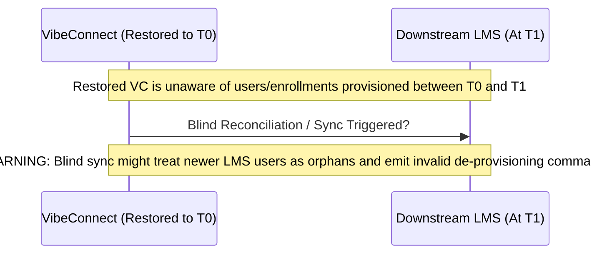

# Runbook 04: Disaster Recovery and Data Consistency

**Target Audience:** SREs, Incident Commanders, Platform Operations  
**Document Classification:** Operational Runbook  
**Last Updated:** Phase 7G  

---

## 1. Disaster Recovery Scenarios & Immediate Responses

This runbook specifies the containment, recovery, and post-incident verification procedures for major platform failure scenarios:

### 1.1. Scenario A: Complete Database Loss or Catastrophic Corruption
1. **Immediate Containment:**  
   Immediately redirect inbound traffic at the edge/load balancer to a static 503 maintenance page. Stop all background workers (`kill` or `systemctl stop vibeconnect-worker`) to prevent partial writes.
2. **Recovery Execution:**  
   Execute the Point-in-Time Recovery (PITR) procedure in the cloud provider console to restore to the timestamp immediately preceding corruption. Restore into a new database instance.
3. **Validation & Cutover:**  
   Execute the 11-point isolated restore validation checklist ([Runbook 03](03_database_backup_and_restore.md)). Update `DATABASE_URL` and restart backend services.
4. **Data Consistency Audit:**  
   Assess the data delta between the restore timestamp and incident timestamp. Proceed to Section 2 (Downstream System Inconsistency).

### 1.2. Scenario B: Accidental Record Deletion / Data Corruption by Superuser
1. **Immediate Containment:**  
   Identify the affected records. Note that `AuditLog` rows cannot be deleted via the ORM, but superuser SQL commands could have corrupted business entities.
2. **Selective Extraction:**  
   Restore the latest backup prior to the accidental deletion into an isolated target database (`vibeconnect_recovery`).
3. **Data Repair via Migration Script:**  
   Export the lost records from `vibeconnect_recovery` and re-insert them into the live database using an audited management command or Python script wrapped in a transaction. **Do not replace the entire live database if only specific rows were deleted.**

### 1.3. Scenario C: Failed or Incomplete Database Migration
1. **Immediate Containment:**  
   Stop the deployment immediately. Do not restart WSGI workers on the new release.
2. **Diagnosis:**  
   Inspect the failed migration traceback in deployment logs and review PostgreSQL schema locks (`pg_stat_activity`).
3. **Safe Rollback:**  
   If the migration failed mid-way and left the schema in an inconsistent state:
   - Check if PostgreSQL rolled back the DDL transaction (PostgreSQL supports transactional DDL).
   - If schema is intact at the prior migration: keep the prior application version running.
   - If schema has corrupted uncommitted tables: restore the pre-migration snapshot into an isolated target, verify, and cut over.

### 1.4. Scenario D: Application Host / Compute Instance Failure
1. **Diagnosis:**  
   Health probes fail (`/api/v1/health/` unreachable), while database is verified healthy via direct DBA connection.
2. **Compute Re-provisioning:**  
   Launch a replacement compute node (virtual machine or container).
3. **Configuration Injection:**  
   Inject verified environment variables from the centralized secrets manager.
4. **Health Check:**  
   Verify `/api/v1/health/` and `/api/v1/health/ready/` before re-adding node to the load balancer pool.

### 1.5. Scenario E: Compromised or Lost Credentials
1. **Emergency Rotation:**  
   If `DJANGO_SECRET_KEY` or `VIBECONNECT_LMS_M2M_SECRET` is compromised, immediately follow the credential rotation runbook in [Runbook 07](07_security_and_access_boundary_operations.md).

---

## 2. Downstream Inconsistency Post-Database Restoration

> [!CRITICAL]
> **The Downstream Asynchrony Risk**  
> If VibeConnect is restored from a backup taken at `T0` following a disaster at `T1`, all state changes occurring between `T0` and `T1` are absent from VibeConnect.  
> However, downstream systems (such as the LMS) may have already received and executed provisioning jobs, user creation, or course enrollments during the `[T0, T1]` window!  
> **Restoring an earlier VibeConnect backup leaves downstream LMS state NEWER than the restored control plane.**

### 2.1. Controlled Assessment Protocol (Mandatory Before Reconciliation)
**Do not run automated reconciliation blindly.** The VibeConnect LMS reconciliation engine (`apps.integration_hub.reconciliation_service`) detects differences, but automated reconciliation must not be triggered until an operator has scoped the damage:

1. **Query Downstream Audit Logs:**  
   Examine downstream LMS logs between `T0` and `T1` to inventory all users, courses, and enrollments created.
2. **Inventory Missing Control Plane Entities:**  
   Identify tenant organizations, subscriptions, or product assignments created in VibeConnect between `T0` and `T1`.
3. **Manual / Scripted Forward-Replay:**  
   Re-create the missing business records in VibeConnect (or replay in-flight provisioning events) to bring VibeConnect's ledger up to date with the downstream LMS.
4. **Execute Dry-Run Reconciliation:**  
   Trigger LMS reconciliation in diagnostic mode:
   - Endpoint: `POST /api/v1/integrations/reconciliation/run/`
   - Scrutinize generated `IntegrationReconciliationIssue` records:
     - `USER_MISSING_DOWNSTREAM`: User exists in VibeConnect but not in LMS.
     - `USER_EXTRA_DOWNSTREAM`: User exists in LMS but not in VibeConnect (likely created between `T0` and `T1`).
     - `MEMBERSHIP_MISMATCH`: Role or organization mismatch.
5. **Human Approval of Discrepancy Resolution:**  
   Review each `IntegrationReconciliationIssue` via `/api/v1/integrations/reconciliation/` and resolve explicitly via `/api/v1/integrations/reconciliation/<uuid:issue_id>/resolve/`.  
   `PLATFORM OWNER APPROVAL REQUIRED: Approve downstream reconciliation resolution plan`.
