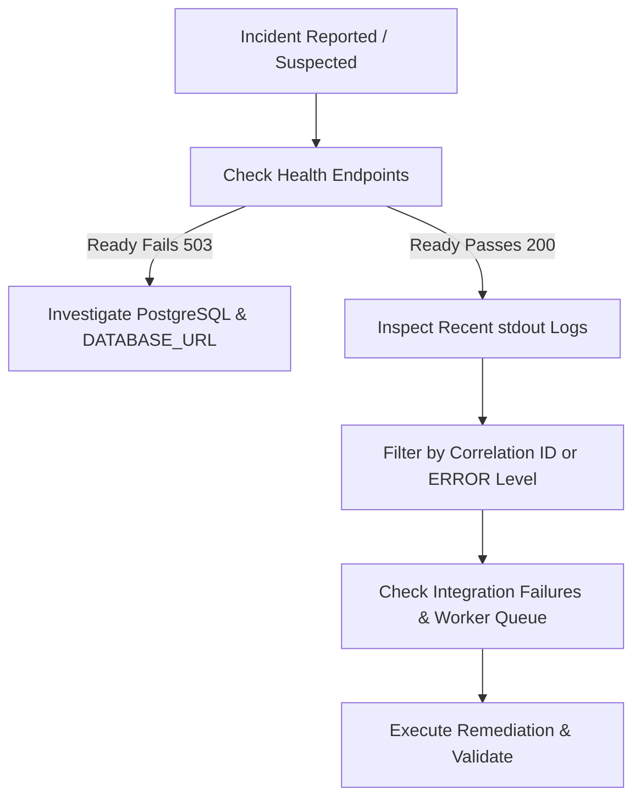

# Runbook 05: Observability and Incident Response

**Target Audience:** SREs, On-Call Engineers, Operations  
**Document Classification:** Operational Runbook  
**Last Updated:** Phase 7G  

---

## 1. Verified Telemetry & Logging Architecture

VibeConnect incorporates a local, standard-library observability foundation implemented in Phase 7D:

### 1.1. Structured JSON Logging
- **Implementation:** `backend/common/logging.py` (`StructuredJsonFormatter`).
- **Log Format:** Standard JSON lines written to `stdout` / `stderr`.
- **Payload Schema:**
  ```json
  {
    "timestamp": "2026-10-10T17:00:00.000000Z",
    "level": "INFO",
    "logger": "common.middleware",
    "message": "HTTP request processed",
    "correlation_id": "c1f8e4b3-7629-4a90-8d51-3fa4e1b8a53e",
    "environment": "production"
  }
  ```
- **Configuration:** Controlled via `DJANGO_LOG_LEVEL` (default: `INFO`) and `DJANGO_LOG_FORMAT` (`json` vs `standard`).

### 1.2. Correlation ID Propagation (`X-Request-ID`)
- **Lifecycle:** Managed by `backend/common/correlation.py` and `backend/common/middleware.py`.
- **Inbound:** Validates incoming `X-Request-ID` against strict pattern `^[A-Za-z0-9_-]{1,64}$`. Generates a standard UUIDv4 if missing or malformed.
- **Context Binding:** Bound to thread-safe Python `ContextVar` (`_correlation_id_ctx`) for the request duration.
- **Outbound HTTP Calls:** Forwarded automatically in downstream HTTP headers by `LmsConnectorClient` (`apps/integration_hub/lms_connector.py`).
- **Response Headers:** Returned to the caller in `X-Request-ID` HTTP response header.

### 1.3. Sensitive Data Redaction
- **Coverage:** Redacts credentials across log messages, formatted tracebacks, query strings, and extra fields:
  - Bearer and Basic authentication headers (`Bearer [REDACTED]`, `Basic [REDACTED]`)
  - Token parameters: `access_token=`, `refresh_token=`, `client_secret=`, `m2m_secret=`
  - Cookie strings: `sessionid=`, `csrftoken=`
  - OAuth authorization codes: `?code=`
- **Known Limitations:**
  - Redaction relies on regex pattern matching and known key names. Custom high-entropy tokens or novel query parameter names in unvetted third-party integrations may escape redaction if not following standard naming conventions.
  - Raw database driver debug logs (`django.db.backends`) should remain at `INFO` or higher in production to prevent query payload leakage.

---

## 2. Health and Readiness Diagnostics

| Endpoint | Probe Type | Verification Performed | Expected Response |
|---|---|---|---|
| `GET /api/v1/health/` | **Liveness** | Verifies web worker process responds | HTTP 200 `{"status": "ok", ...}` |
| `GET /api/v1/health/ready/` | **Readiness** | Executes `SELECT 1;` on PostgreSQL | HTTP 200 `{"status": "ready", "database": "healthy"}` |

---

## 3. Outstanding Observability Gaps

The following capabilities are **not configured** within the repository and require external tooling:

| Capability | Status | Required Action / Description |
|---|---|---|
| **Centralized Log Aggregation** | `EXTERNAL INFRASTRUCTURE NOT VERIFIED` | Logs currently emit to container stdout. Requires external shipping agent (e.g., Vector, FluentBit, CloudWatch Agent, Datadog Agent). |
| **APM & Metrics Collection** | `EXTERNAL INFRASTRUCTURE NOT VERIFIED` | No Prometheus exporter or APM SDK (Datadog/NewRelic) installed. |
| **Distributed Tracing** | `EXTERNAL INFRASTRUCTURE NOT VERIFIED` | OpenTelemetry collector and trace exporter not configured. |
| **Worker Liveness Heartbeat** | `EXTERNAL INFRASTRUCTURE NOT VERIFIED` | Background workers have no persistent heartbeat table or external watchdog process. |
| **Alert Routing & Paging** | `ALERT DELIVERY NOT VERIFIED` | No PagerDuty, Opsgenie, or Slack webhook alert routes configured. |

---

## 4. Practical Incident Response Under Current Capabilities

Given that automated alerting and centralized APM are pending external configuration, on-call operators must use local diagnostic commands during incidents:

### 4.1. Incident Triage Workflow



### 4.2. Local Log Triage Commands
When investigating an error reported by a user with an `X-Request-ID`:
```bash
# Filter logs by correlation ID (Linux host / container logs)
journalctl -u vibeconnect-backend -n 1000 | grep "correlation_id\":\"<request-id>"

# Filter recent ERROR-level events
journalctl -u vibeconnect-backend -n 500 | grep "\"level\":\"ERROR\""
```

### 4.3. Checking Background Worker & Integration Queue Health
```bash
# 1. Check for stuck or orphaned integration jobs
python manage.py detect_stuck_integration_jobs --limit 50

# 2. Check for dead-letter failures via Django shell
python manage.py shell -c "
from apps.integration_hub.models import IntegrationFailure, FailureStatus;
failures = IntegrationFailure.objects.filter(status=FailureStatus.DEAD_LETTER).count();
print(f'Dead-letter count: {failures}')
"
```
