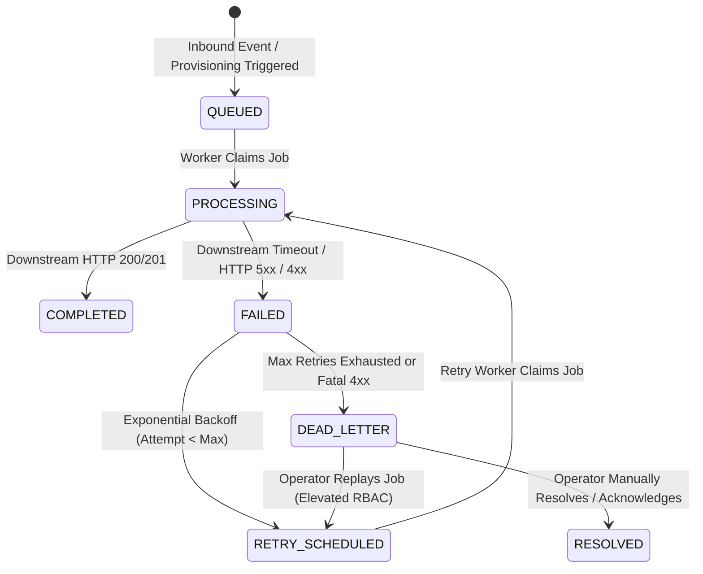

# Runbook 06: Integration and Dead-Letter Recovery

**Target Audience:** Support Engineers, Integration Operations, Platform Administrators  
**Document Classification:** Operational Runbook  
**Last Updated:** Phase 7G  

---

## 1. Integration Pipeline & Failure State Machine

The VibeConnect Integration Hub (`apps/integration_hub/`) manages asynchronous event ingestion, downstream LMS provisioning, and error resilience.



### 1.1. Core Failure Entities
- **`IntegrationFailure`:** Persists failed execution attempts, full exception details, payload extracts, and retry metadata.
- **`ProvisioningJob`:** Represents the asynchronous provisioning task (e.g., student account creation, course enrollment).
- **`ConnectorInstance`:** Tenant-scoped binding connecting an organization to a specific external LMS.

---

## 2. Inspecting Failures and Health

Operators can inspect integration pipeline health via both REST APIs and CLI commands:

### 2.1. REST API Endpoints

| Endpoint | Role / Permission Required | Purpose |
|---|---|---|
| `GET /api/v1/integrations/health/` | Platform Owner | Global aggregated connector health summary. |
| `GET /api/v1/integrations/failures/` | Platform Owner | Global list of integration failures with status filters. |
| `GET /api/v1/integrations/failures/<uuid:pk>/` | Platform Owner | Detailed stack trace and payload of a specific failure. |
| `GET /api/v1/support/organizations/<uuid:org_id>/failures/` | Support Tier 1+ (`support.diagnostics.view`) | Tenant-isolated failure list for a specific organization. |
| `GET /api/v1/support/organizations/<uuid:org_id>/failures/<uuid:id>/` | Support Tier 1+ (`support.diagnostics.view`) | Detailed failure diagnostics for a specific tenant incident. |

### 2.2. CLI Diagnostic Commands
```bash
# 1. Run stuck job detection to find stalled QUEUED or PROCESSING jobs
python manage.py detect_stuck_integration_jobs --limit 50

# 2. Count failures by status in the Django shell
python manage.py shell -c "
from apps.integration_hub.models import IntegrationFailure;
from django.db.models import Count;
print(IntegrationFailure.objects.values('status').annotate(total=Count('id')))
"
```

---

## 3. Elevated Recovery Operations & Permission Boundaries

Recovering from integration failures requires explicit role permissions. The platform enforces strict separation of privileges:

### 3.1. Replaying Dead-Letter Failures
Replaying a `DEAD_LETTER` failure resets its retry counter and reschedules execution:

- **Via Platform Owner Console:**
  - `POST /api/v1/integrations/failures/<uuid:pk>/replay/`
  - Requires: Platform Owner account.
- **Via Support Operator Console:**
  - `POST /api/v1/support/organizations/<uuid:org_id>/failures/<uuid:failure_id>/replay/`
  - Requires: Support Tier 2 or Support Admin with permission `support.operations.retry`.
  - **Mandatory Payload:** Must include an operational reason between 1 and 500 characters:
    ```json
    {
      "reason": "Downstream LMS maintenance completed; replaying failed enrollment"
    }
    ```
  - **Audit Guarantee:** The operation automatically records an immutable `AuditLog` entry tying the operator to the replay action.

### 3.2. Marking as Dead-Letter or Resolving
- **Schedule Retry:** `POST /api/v1/integrations/failures/<uuid:pk>/schedule-retry/` (Manually triggers retry backoff).
- **Mark Dead Letter:** `POST /api/v1/integrations/failures/<uuid:pk>/mark-dead-letter/` (Halts automatic retries for unrecoverable errors).
- **Resolve:** `POST /api/v1/integrations/failures/<uuid:pk>/resolve/` (Acknowledges issue as fixed via out-of-band means).

---

## 4. Escalation and Circuit Breaking

### 4.1. When Repeated Retries Must Stop
Automatic retries must be stopped and the incident escalated when:
1. **Downstream Authentication Failure:** HTTP 401/403 responses indicate expired M2M credentials or invalid signing secrets (`VIBECONNECT_LMS_M2M_SECRET`). Retrying will not succeed until credentials are rotated.
2. **Schema Incompatibility:** HTTP 400/422 responses indicate the downstream LMS rejected the payload format. Continued retries will repeatedly fail and pollute downstream logs.
3. **Downstream Outage Exceeding 1 Hour:** Set failures to `DEAD_LETTER` and notify the downstream LMS platform administrator.

### 4.2. Downstream LMS Unavailability Caveat
> [!NOTE]
> If the downstream LMS backend (`VIBECONNECT_LMS_BACKEND_URL`) is unreachable or network-partitioned, VibeConnect will safely capture failures into `IntegrationFailure`. However, **VibeConnect cannot verify downstream data consistency or determine whether half-open HTTP connections resulted in partial writes in the LMS**. After restoring LMS connectivity, trigger a dry-run reconciliation ([Runbook 04](04_disaster_recovery_and_data_consistency.md)).
