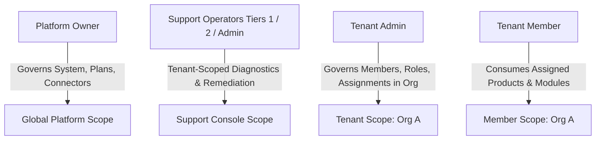

# Runbook 07: Security and Access Boundary Operations

**Target Audience:** Security Engineers, Platform Administrators, Support Leadership  
**Document Classification:** Operational Runbook  
**Last Updated:** Phase 7G  

---

## 1. Confirmed Principal and Role Boundaries

VibeConnect implements a strict four-tier principal hierarchy. Privileges must never be conflated or bypassed:



### 1.1. Role Privilege Matrix

| Principal Role | Scope | Key Capabilities | Prohibitions / Ceilings |
|---|---|---|---|
| **Platform Owner** | Global | Full system governance, commercial plans, pricing, global connectors, raw developer keys. | None within application domain. |
| **Support Admin** | Global / Tenant | Diagnostics, failure retries, time-limited support impersonation. | Cannot modify global product catalog or commercial pricing. |
| **Support Tier 2** | Global / Tenant | Diagnostics, scheduled retries, replaying dead-letter jobs (`support.operations.retry`). | Cannot initiate impersonation sessions. |
| **Support Tier 1** | Global / Tenant | Read-only diagnostics (`support.diagnostics.view`). | Zero mutation permissions. |
| **Tenant Admin** | Tenant (`org_id`) | User invitations, product seat assignments, tenant custom roles. | Strictly bounded by `OrganizationPermissionCeiling`. Cannot cross tenant boundaries. |
| **Tenant Member** | Tenant (`org_id`) | Launching assigned products, SSO redirection to LMS. | Zero administrative permissions. |

> [!CAUTION]
> **Strict Operational Rule: Never Weaken Permissions as a Workaround**  
> Never recommend promoting a Tenant Member to Tenant Admin or granting Platform Owner access to resolve a support incident or unblock a user. Never disable RBAC middleware or bypass permission checks.

---

## 2. Support Impersonation Safeguards

Support impersonation allows authorized operators to view the tenant console from the perspective of an end user or tenant administrator to diagnose issues:

1. **Permission Requirement:** Only operators with `support.impersonation.create` (Support Admin) can generate a session.
2. **Mandatory Justification:** Every session requires an external support ticket ID and validated operational reason.
3. **Time-Limited:** Sessions expire automatically after the configured session window (maximum 60 minutes).
4. **Ceiling Bounds:**
   - Impersonating a user does NOT grant the operator access to mutate live data. All write/mutation endpoints reject requests originating from an active impersonation session (`read_only_impersonation=True`).
   - Operators can **never** impersonate Platform Owners or other Support Operators.
5. **Audit Logging:** Impersonation session initiation, token generation, and termination are permanently recorded in `SupportImpersonationSession` and `AuditLog`.

---

## 3. Personal Data Pseudonymization & Erasure Protocol

To satisfy privacy regulations (GDPR Art. 17 / CCPA) without violating audit log immutability:

1. **Execute Canonical Service:**  
   Erasure requests must be fulfilled exclusively via `apps.identity.services.anonymize_user(user_id, actor)`:
   ```bash
   python manage.py shell -c "
   from apps.identity.services import anonymize_user;
   from apps.identity.models import PlatformUser;
   user = PlatformUser.objects.get(email='user@example.com');
   anonymize_user(user_id=user.id, actor=None);
   print('User successfully anonymized.');
   "
   ```
2. **What Is Anonymized:**
   - `email` replaced with `anonymized-<uuid>@redacted.vibeconnect.local`
   - `full_name` replaced with `"Redacted User"`
   - `is_active` set to `False`, `status` set to `DISABLED`
   - Password hash cleared to an unusable string
   - SSO provider IDs and external subject IDs cleared (`None`)
3. **What Is Preserved (Referential Integrity):**
   - The primary key UUID is retained to prevent foreign key cascade errors on tables using `on_delete=models.PROTECT`.
   - Historical `AuditLog` rows remain unmutated as immutable forensic history.

---

## 4. Emergency Credential Rotation Procedures

### 4.1. Rotating `DJANGO_SECRET_KEY`
- **Impact:** Invalidates all active user sessions and CSRF tokens across the platform. Requires all users to re-authenticate.
- **Procedure:**
  1. Generate a new high-entropy secret key:
     ```bash
     python -c 'import secrets; print(secrets.token_urlsafe(64))'
     ```
  2. Update `DJANGO_SECRET_KEY` in the environment configuration on all application nodes.
  3. Restart all backend WSGI application workers simultaneously.

### 4.2. Rotating `VIBECONNECT_LMS_M2M_SECRET`
- **Impact:** Disrupts Machine-to-Machine communication between VibeConnect and the downstream LMS until synchronized.
- **Procedure:**
  1. Schedule a coordinated maintenance window with the downstream LMS administrator.
  2. Generate a new 64-character secret key.
  3. Update `VIBECONNECT_LMS_M2M_SECRET` in VibeConnect's environment.
  4. Update the corresponding signing secret in the downstream LMS backend.
  5. Restart both services and execute a test M2M token validation.

### 4.3. Rotating PostgreSQL Database Password
- **Impact:** Backend database connection loss if not updated cleanly.
- **Procedure:**
  1. Update the database user's password in PostgreSQL:
     ```sql
     ALTER USER vibeconnect_app WITH PASSWORD '<new_password>';
     ```
  2. Immediately update `DATABASE_URL` across all backend nodes and worker servers.
  3. Perform a zero-downtime rolling restart of backend WSGI workers.
  4. Verify `/api/v1/health/ready/`.
