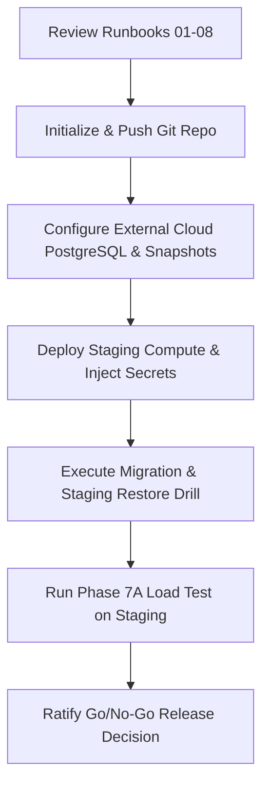

# Runbook 08: Release Gates and Production Handoff

**Target Audience:** Release Managers, Technical Leadership, Platform Owners  
**Document Classification:** Operational Runbook  
**Last Updated:** Phase 7G  

---

## 1. Phase 7 Production Readiness Gates Ledger

The following ledger establishes the comprehensive status of all Phase 7 production readiness gates. Status classifications reflect verifiable project evidence:

| Workstream | Name | Repository-Side Status | External / Production Status | Outstanding Action / Blocker |
|---|---|---|---|---|
| **Phase 7A** | Load, Stress & Soak Testing | **PENDING** | `STAGING NOT VERIFIED` | Awaiting platform owner workload profile and test execution in isolated staging. |
| **Phase 7B** | Security & Boundaries | **VERIFIED** (115/115 tests passed) | `EXTERNAL INFRASTRUCTURE NOT VERIFIED` | Edge/WAF rate limiting and penetration audit remain external items. |
| **Phase 7C** | Backup & Disaster Recovery | **AUDITED & PLANNED** | `RESTORE PROCEDURE NOT YET EXECUTED` | Requires RPO/RTO approval and isolated restore drill against cloud snapshots. |
| **Phase 7D** | Observability & Telemetry | **PARTIAL** (Structured logs, correlation ID, readiness probe) | `ALERT DELIVERY NOT VERIFIED` | Centralized log aggregation, APM metrics, distributed tracing, and alerts pending. |
| **Phase 7E** | Performance & Capacity | **AUDITED** | `EXTERNAL INFRASTRUCTURE NOT VERIFIED` | Baseline RPS, latency percentiles, and profiling depend on Phase 7A staging execution. |
| **Phase 7F** | Staging & Rollout Readiness | **CHECKLIST PREPARED** | `OPERATOR ACTION REQUIRED` | Operator manual deployment, Git management, and live server configuration. |
| **Phase 7G** | Documentation & Runbooks | **COMPLETED** | Complete | Runbooks authored in `docs/runbooks/` and architecture guides updated. |

---

## 2. Outstanding Production Blockers

Before the platform can be approved for general production traffic, the following specific items must be closed:

### 2.1. Blocker 1: Downstream LMS Webhook Receiver Acceptance (Phase 6B)
- **Description:** VibeConnect dispatches developer and integration webhooks. Acceptance testing of the downstream LMS webhook receiver endpoint under live network conditions is pending.
- **Resolution:** Execute end-to-end webhook delivery verification once the staging LMS endpoint is live. `EXTERNAL INFRASTRUCTURE NOT VERIFIED`.

### 2.2. Blocker 2: Edge Reverse-Proxy Security Headers (Phase 6F)
- **Description:** Application settings enforce `SECURE_SSL_REDIRECT`, HSTS, and CSP headers. However, edge CDN and reverse-proxy (Cloudflare / ALB / Nginx) header preservation, TLS 1.3 enforcement, and gzip/brotli compression remain unverified on the live network.
- **Resolution:** Execute curl/OpenSSL verification against the public staging domain once configured. `EXTERNAL INFRASTRUCTURE NOT VERIFIED`.

### 2.3. Blocker 3: Platform Owner RPO and RTO Approval (Phase 7C)
- **Description:** Maximum allowable data loss (RPO) and maximum allowable downtime (RTO) must be ratified by executive stakeholders.
- **Resolution:** Ratify targets in platform SLA documentation. `PLATFORM OWNER APPROVAL REQUIRED`.

### 2.4. Blocker 4: Isolated Restore Drill Execution (Phase 7C)
- **Description:** Database backup files exist, but a full automated restoration drill into an isolated staging target database has not yet been executed.
- **Resolution:** Execute the 11-point restore validation procedure ([Runbook 03](03_database_backup_and_restore.md)). `RESTORE PROCEDURE NOT YET EXECUTED`.

### 2.5. Blocker 5: Staging Load and Stress Testing (Phase 7A)
- **Description:** The system has not yet been subjected to concurrent user load, stress saturation, or 24-hour soak testing.
- **Resolution:** Formulate test scenarios (Locust/k6) and execute against isolated staging environment.

---

## 3. Human Operator Production Handoff Checklist

Because automated CI/CD and direct agent server administration are prohibited, the human operator must execute the following physical steps:

- [ ] **Step 1: Git Repository Management:**  
  Manually initialize the Git repository, add files, create the initial release commit, tag `v1.0.0-rc1`, and push to the remote repository. `OPERATOR ACTION REQUIRED`.
- [ ] **Step 2: External PostgreSQL Configuration:**  
  Provision a managed PostgreSQL 15+ instance with automated daily snapshots and continuous WAL archiving enabled. `OPERATOR ACTION REQUIRED`.
- [ ] **Step 3: Staging Infrastructure Setup:**  
  Deploy backend compute and frontend static hosting in an isolated staging environment matching production specifications. `OPERATOR ACTION REQUIRED`.
- [ ] **Step 4: Environment Variables Injection:**  
  Securely inject all mandatory environment variables into staging via a secret manager. `OPERATOR ACTION REQUIRED`.
- [ ] **Step 5: Migration Execution:**  
  Execute `python manage.py migrate --settings=config.settings.production` on staging.
- [ ] **Step 6: Restore Drill Execution:**  
  Capture a staging snapshot, restore it into an isolated test target, and complete the 11-point validation checklist.
- [ ] **Step 7: Load & Soak Testing:**  
  Execute load tests against staging up to the platform owner's approved concurrency target.
- [ ] **Step 8: Final Go / No-Go Decision:**  
  Obtain written platform owner sign-off across all 8 gates before switching live DNS. `PLATFORM OWNER APPROVAL REQUIRED`.
